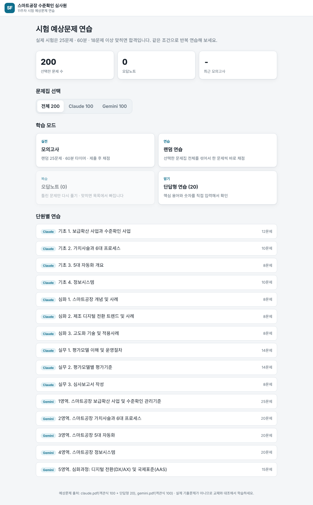
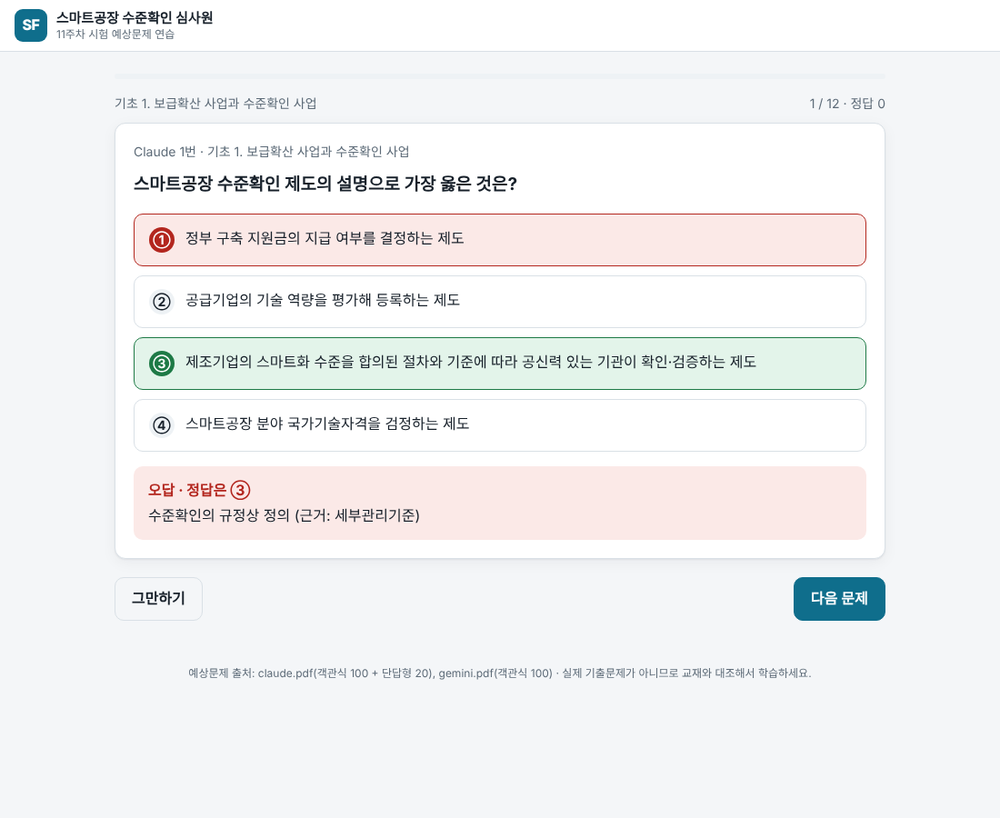
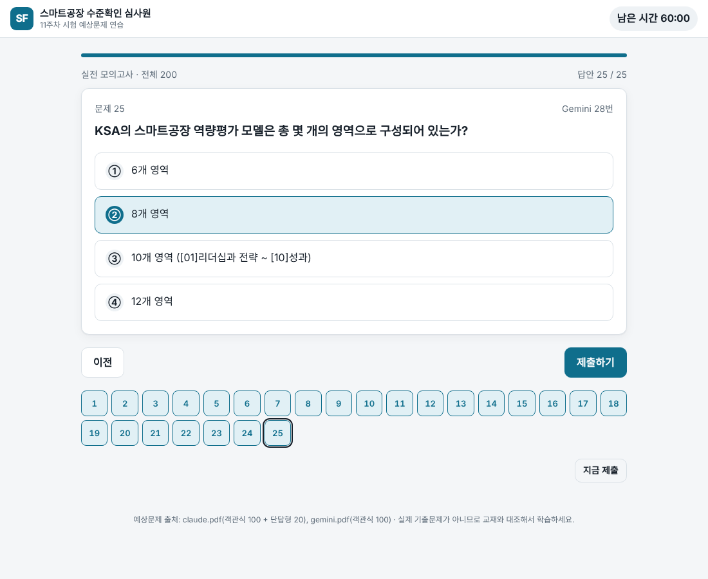
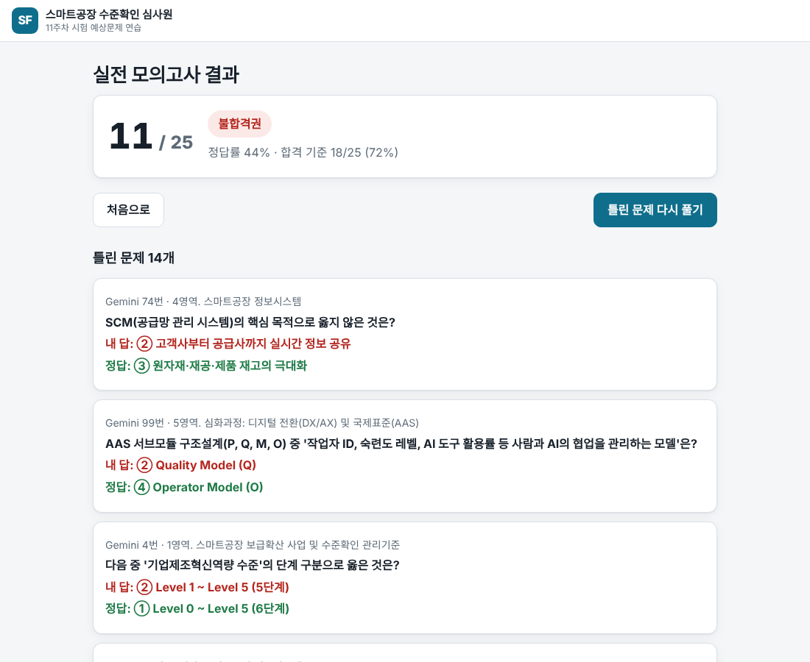
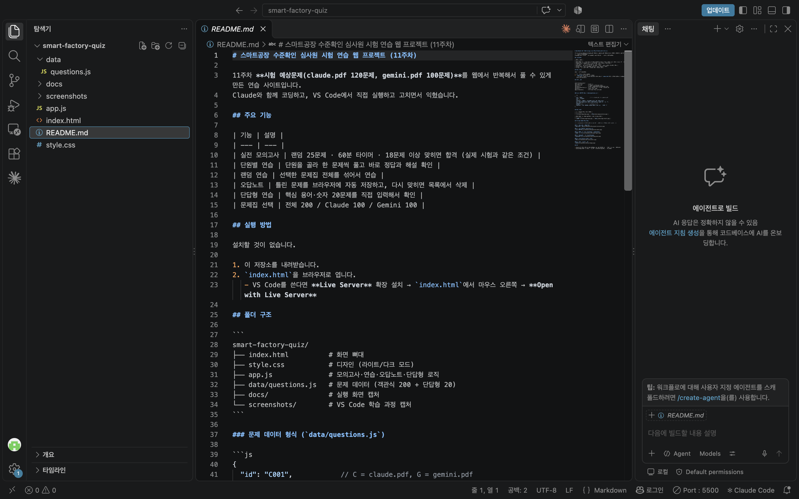
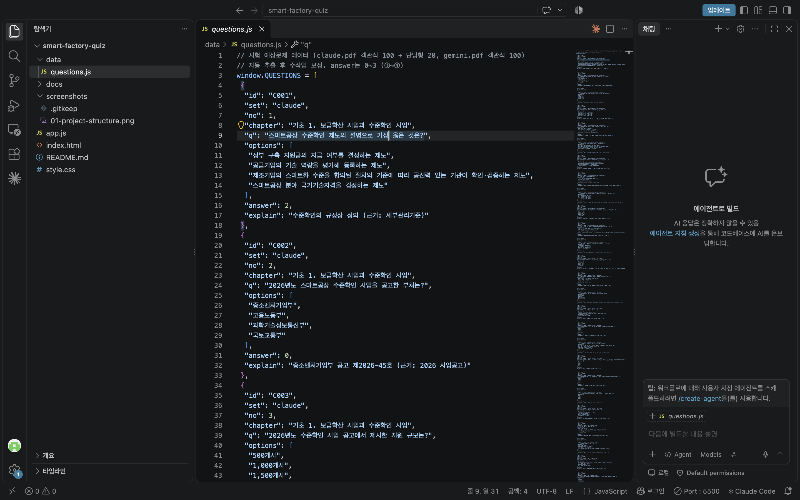
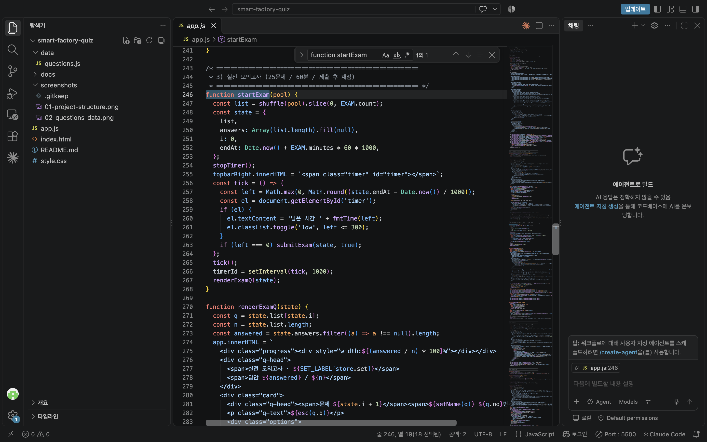
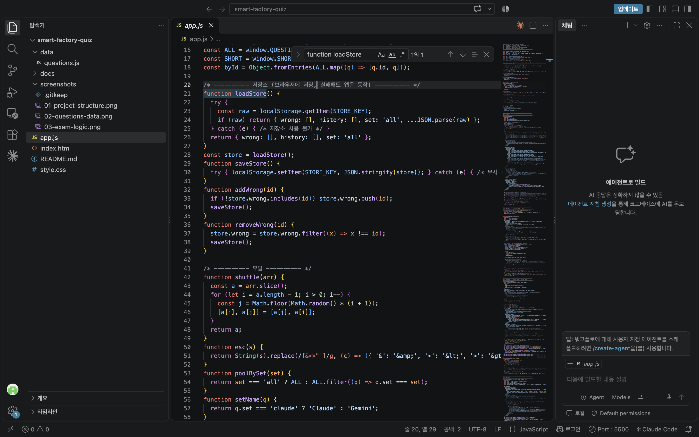
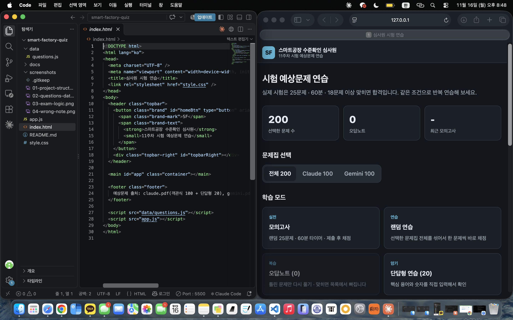
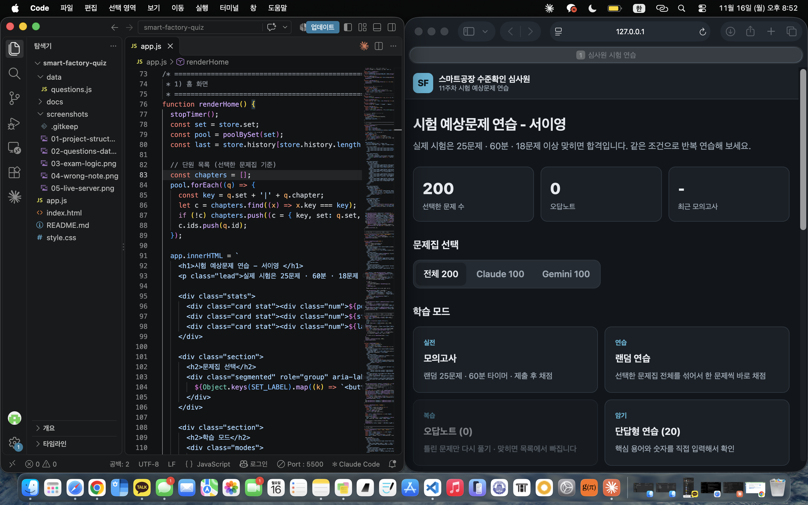

# 스마트공장 수준확인 심사원 시험 연습 웹 프로젝트 (11주차)

11주차 **시험 예상문제(claude.pdf 120문제, gemini.pdf 100문제)**를 웹에서 반복해서 풀 수 있게 만든 연습 사이트입니다.
Claude와 함께 코딩하고, VS Code에서 직접 실행하고 고치면서 익혔습니다.

## 주요 기능

| 기능 | 설명 |
| --- | --- |
| 실전 모의고사 | 랜덤 25문제 · 60분 타이머 · 18문제 이상 맞히면 합격 (실제 시험과 같은 조건) |
| 단원별 연습 | 단원을 골라 한 문제씩 풀고 바로 정답과 해설 확인 |
| 랜덤 연습 | 선택한 문제집 전체를 섞어서 연습 |
| 오답노트 | 틀린 문제를 브라우저에 자동 저장하고, 다시 맞히면 목록에서 삭제 |
| 단답형 연습 | 핵심 용어·숫자 20문제를 직접 입력해서 확인 |
| 문제집 선택 | 전체 200 / Claude 100 / Gemini 100 |

## 실행 방법

설치할 것이 없습니다.

1. 이 저장소를 내려받습니다.
2. `index.html`을 브라우저로 엽니다.
   - VS Code를 쓴다면 **Live Server** 확장 설치 → `index.html`에서 마우스 오른쪽 → **Open with Live Server**

## 폴더 구조

```
smart-factory-quiz/
├── index.html          # 화면 뼈대
├── style.css           # 디자인 (라이트/다크 모드)
├── app.js              # 모의고사·연습·오답노트·단답형 로직
├── data/questions.js   # 문제 데이터 (객관식 200 + 단답형 20)
├── docs/               # 실행 화면 캡처
└── screenshots/        # VS Code 학습 과정 캡처
```

### 문제 데이터 형식 (`data/questions.js`)

```js
{
  "id": "C001",            // C = claude.pdf, G = gemini.pdf
  "set": "claude",
  "no": 1,
  "chapter": "기초 1. 보급확산 사업과 수준확인 사업",
  "q": "스마트공장 수준확인 제도의 설명으로 가장 옳은 것은?",
  "options": ["...", "...", "...", "..."],
  "answer": 2,             // 0~3 → ①~④
  "explain": "수준확인의 규정상 정의 (근거: 세부관리기준)"
}
```

## 실행 화면

| 홈 | 단원별 연습 (바로 채점) |
| --- | --- |
|  |  |

| 실전 모의고사 (60분 타이머) | 결과 · 오답 확인 |
| --- | --- |
|  |  |

## VS Code 반복 연습 기록

<!-- screenshots 폴더에 캡처 파일을 넣고, 아래 파일 이름을 맞춰 주세요. -->

### 1. 프로젝트 구조와 실행


### 2. 문제 데이터 (questions.js)


### 3. 모의고사 로직 (startExam / submitExam)


### 4. 오답노트 저장 (localStorage)


### 5. Live Server로 실행한 결과


### 6. 직접 고쳐 본 부분


## 참고

- 예상문제는 실제 기출문제가 아니므로 교재와 2026년 세부관리기준으로 꼭 대조하세요.
- 오답노트와 모의고사 기록은 브라우저(localStorage)에만 저장됩니다.
